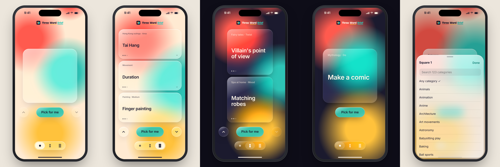

<picture>
  <source media="(prefers-color-scheme: dark)" srcset="brand/logo-horizontal-dark.svg">
  
</picture>

# Three Word Brief

A random picker for things to make, do, cook, play and learn. Up to three Liquid Glass cards land on random categories, and you can step down layer by layer to the exact thing: a real phrase, song, dish, place or product.

Every pick comes from a fixed list using the device's secure random generator. Nothing is chosen by AI when the app runs, so playing it costs no AI tokens.



## Two versions

- `index.html`: tap **Pick for me** and each card lands on a specific thing. Tap a card to go one layer deeper.
- `explore.html`: **Pick for me** deals categories only. The **down arrow** (right) takes every card one layer deeper at random, and the **up arrow** (left) steps back without re-rolling.

Both: the switch at the bottom sets 1, 2 or 3 cards; hold a card to lock it to a category; cards in one pick never share a category.

## The database

| File | What it holds |
|---|---|
| `build_db.py` | The seven original deep categories (Music, Drawing, Cooking, Writing, Movement, Photography, Making) |
| `more_categories.txt` | The other categories, one per line: `Category \| Facet: item, item \| Facet: item` |
| `exact_items.txt` | Exact names under an item: `Category > Item: Name; Name` |
| `deeper_items.txt` | The actual thing behind an instruction, with optional English notes: `Category > Item: Name \| note; Name` and `Category > Item = note` |
| `categories.json` | Built output that the apps read. Don't edit by hand |

After editing any `.txt` file:

```
python3 build_db.py
```

It prints anything it couldn't match. Currently 123 categories and about 1,730 end points.

`picker.py` picks from the terminal and checks fairness:

```
python3 picker.py Music Drawing --depth 3
python3 picker.py --test
```

## Brand

`brand/` holds the logo (light and dark horizontal versions) and the favicon. `icons/` holds the sizes made from it: a 32 px tab icon, the 180 px iPhone home-screen icon, and 192 and 512 px icons for `manifest.webmanifest`. The app uses the logo at the top of the screen and the logo's palette throughout: coral `#FF5A4E`, sun `#FFC23C`, teal `#2EC4B6`, navy `#1B1A2E` and cream `#FFF6E9`.

## Hosting on GitHub Pages

Settings > Pages > Build and deployment > Deploy from a branch > `main` / root. The app is then live at `https://sophiang1227.github.io/three-word-brief/` (explore version at `/explore.html`). On iPhone, open it in Safari and use Share > Add to Home Screen.

## iOS app

`ios/ThreeWordBrief/` is a SwiftUI version using Apple's Liquid Glass APIs (iOS 26, Xcode 26). It has the original pick mode; the explore mode and the note line are not ported yet. It has not been compiled yet. See its README for setup.
