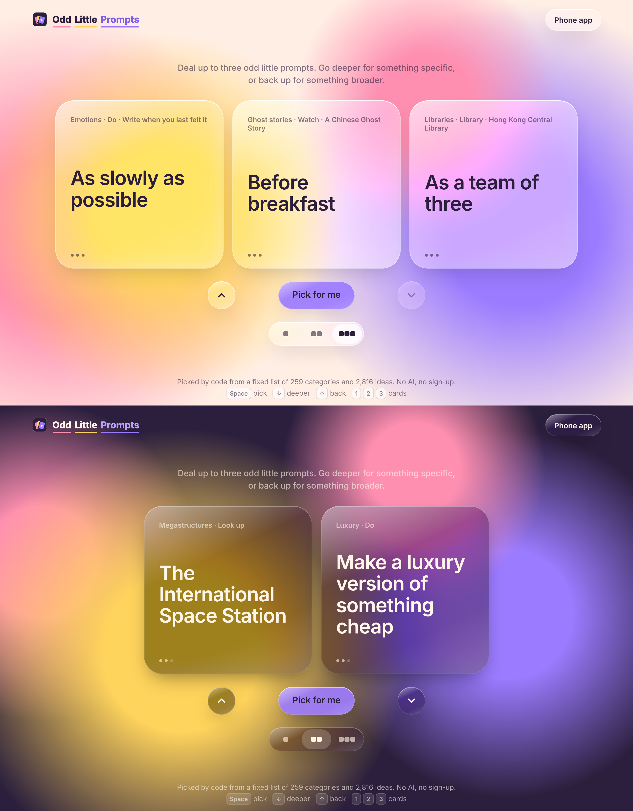

  

  <picture>
    <source media="(prefers-color-scheme: dark)" srcset="brand/logo-horizontal-dark.svg">
    
  </picture>

  
  
  

  

Deal up to three random prompts, then go deeper for something specific or back up for something broader. Every pick comes from a fixed list using the device's secure random generator. Nothing is chosen by AI when it runs, so playing costs no AI tokens.

## How it works

- **Pick for me** deals a fresh category onto each card. It is the only thing that changes categories. Categories come from a shuffle bag: every one turns up once, in random order, before any repeats (about 86 picks of three cards).
- **Down arrow** (right) takes every card one layer deeper at random. **Up arrow** (left) steps back without re-rolling. Every item has at least three layers: where there is nothing more specific underneath, the third layer is a twist (a time limit, who with, where, a rule, scale, style, how to share it) or a mash-up with an item from a different category.
- **Hold a card** to lock it to a category. The switch at the bottom sets 1, 2 or 3 cards.
- On the website: <kbd>Space</kbd> picks, <kbd>↓</kbd> <kbd>↑</kbd> change layer, <kbd>1</kbd> <kbd>2</kbd> <kbd>3</kbd> set the number of cards.

## Pages

| File | What it is |
|---|---|
| `index.html` | The website: cards side by side on a laptop, stacked on a phone. The official Buy Me a Coffee button sits top right (for buymeacoffee.com/sophiang.builds); if their script can't load, a plain backup link in the same spot appears instead |
| `sketchbook-warm-ups/index.html` | A static guide with three five-minute sketchbook exercises; links back to the deck and to `/#drawing`, which opens one card locked to Drawing with a specific idea dealt |
| `app.html` | The phone app: Liquid Glass screen, shown inside an iPhone 15 frame on wider screens. "Add to Home Screen" opens this one |

## Security

Page code lives in `assets/site.js` and `assets/app.js` (no inline scripts), and each page carries a Content Security Policy. See `SECURITY.md` before adding any outside service.

## Search setup

- The homepage and guide each have their own title, description, canonical URL (on `oddlittleprompts.com`) and sharing preview. Their copy, examples and questions are plain HTML, so search engines and AI assistants can read them without running the deck.
- `app.html` is marked `noindex`: it is the installed phone app, not a search page.
- `robots.txt` allows all crawlers and points to `sitemap.xml`, which lists the two indexable pages. To keep AI training crawlers out while staying in AI search, add `Disallow: /` groups for `GPTBot` and `ClaudeBot` only.

## The database

| File | What it holds |
|---|---|
| `build_db.py` | The seven original deep categories (Music, Drawing, Cooking, Writing, Movement, Photography, Making) |
| `more_categories.txt` | The other categories, one per line: `Category \| Facet: item, item \| Facet: item` |
| `exact_items.txt` | Exact names under an item: `Category > Item: Name; Name` |
| `twists.txt` | The twist deck that gives every item a third layer, including the cross-category mash-up |
| `deeper_items.txt` | The actual thing behind an instruction, with optional English notes: `Category > Item: Name \| note; Name` and `Category > Item = note` |
| `categories.json`, `twists.json` | Built output that the pages read. Don't edit by hand |

After editing any `.txt` file, run `python3 build_db.py`. It prints anything it couldn't match. Currently 259 categories and 2,816 end points. The second round of categories was found by pushing on opposites (tiny and huge, old and new, loud and quiet, real and fake, order and chaos) and then sweeping the big themes the first round missed; see the comments in `more_categories.txt`. `python3 picker.py --test` checks the picks are even.

## Brand

`brand/` holds the logo (light and dark), the favicon and `make_logo.py`, which rebuilds them (the wordmark needs Inter ExtraBold and `pip install fonttools`). Brand colours, used by the logo and the app alike: pink `#FF8FB1`, butter `#FFD45C` and lilac `#9B7BFF` on plum `#2B1F3D`, with cream `#FFF6E9` as the light ground.

`docs/social-preview.png` (1280 × 640) is the image to upload under Settings > General > Social preview, so links to the repo show the logo. `icons/` holds the 32 px tab icon, the 180 px iPhone home-screen icon and the 192 and 512 px icons for `manifest.webmanifest`.

## Hosting on GitHub Pages

Settings > Pages > Build and deployment > Deploy from a branch > `main` / root. The site is at `https://sophiang-builds.github.io/odd-little-prompts/` and the phone app at `/app.html`.

## iOS app

`ios/OddLittlePrompts/` is a SwiftUI version using Apple's Liquid Glass APIs (iOS 26, Xcode 26). It has not been compiled yet and still uses the earlier pick mode. See its README.
