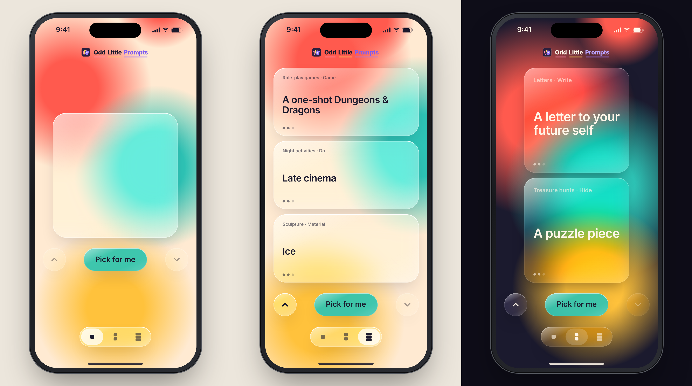
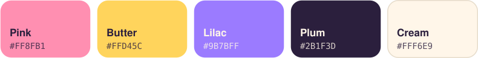

  

  <picture>
    <source media="(prefers-color-scheme: dark)" srcset="brand/logo-horizontal-dark.svg">
    
  </picture>

  
  
  

Deal up to three random prompts, then go deeper for something specific or back up for something broader. Every pick comes from a fixed list using the device's secure random generator. Nothing is chosen by AI when it runs, so playing costs no AI tokens.

## How it works

- **Pick for me** deals a fresh category onto each card. It is the only thing that changes categories.
- **Down arrow** (right) takes every card one layer deeper at random. **Up arrow** (left) steps back without re-rolling.
- **Hold a card** to lock it to a category. The switch at the bottom sets 1, 2 or 3 cards.
- On the website: <kbd>Space</kbd> picks, <kbd>↓</kbd> <kbd>↑</kbd> change layer, <kbd>1</kbd> <kbd>2</kbd> <kbd>3</kbd> set the number of cards.

## Pages

| File | What it is |
|---|---|
| `index.html` | The website: cards side by side on a laptop, stacked on a phone |
| `app.html` | The phone app: Liquid Glass screen, shown inside an iPhone 15 frame on wider screens. "Add to Home Screen" opens this one |

## The database

| File | What it holds |
|---|---|
| `build_db.py` | The seven original deep categories (Music, Drawing, Cooking, Writing, Movement, Photography, Making) |
| `more_categories.txt` | The other categories, one per line: `Category \| Facet: item, item \| Facet: item` |
| `exact_items.txt` | Exact names under an item: `Category > Item: Name; Name` |
| `deeper_items.txt` | The actual thing behind an instruction, with optional English notes: `Category > Item: Name \| note; Name` and `Category > Item = note` |
| `categories.json` | Built output that the pages read. Don't edit by hand |

After editing any `.txt` file, run `python3 build_db.py`. It prints anything it couldn't match. Currently 123 categories and about 1,730 end points. `python3 picker.py --test` checks the picks are even.

## Brand

`brand/` holds the logo (light and dark), the favicon and `make_logo.py`, which rebuilds them (the wordmark needs Inter ExtraBold and `pip install fonttools`). Logo colours: pink `#FF8FB1`, butter `#FFD45C` and lilac `#9B7BFF` cards on plum `#2B1F3D`, with cream `#FFF6E9` for the sparkle and text on dark.

`docs/social-preview.png` (1280 × 640) is the image to upload under Settings > General > Social preview, so links to the repo show the logo. `icons/` holds the 32 px tab icon, the 180 px iPhone home-screen icon and the 192 and 512 px icons for `manifest.webmanifest`.

## Hosting on GitHub Pages

Settings > Pages > Build and deployment > Deploy from a branch > `main` / root. Once the repository is renamed to `odd-little-prompts`, the site is at `https://sophiang1227.github.io/odd-little-prompts/` and the phone app at `/app.html`.

## iOS app

`ios/OddLittlePrompts/` is a SwiftUI version using Apple's Liquid Glass APIs (iOS 26, Xcode 26). It has not been compiled yet and still uses the earlier pick mode. See its README.
